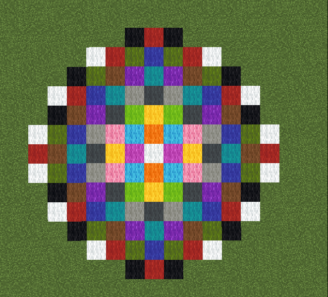
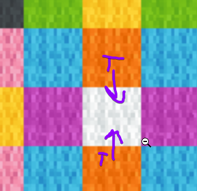
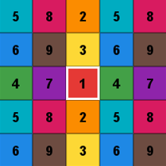

# Nether Order

A Fabric mod for Minecraft 1.16.1 that makes nether decoration (huge fungi, glowstone, vines, roots, ores) come out deterministically based on the seed.

## The problem

In 1.16.1, two different players on the same seed in the nether can have different trees and/or glowstone depending on what direction they came from or what hardware they have.


A chunk's decorator can write into its any adjacent chunk in a 3x3 radius. A nether tree's cap can spill over 4 or 5 blocks into a neighbouring chunk.

When a tree cap is placed it rolls for a block if that spot is free. If a neighbour's spill got there first, the rolls are skipped, leading to drift in the chunk's rng. The 8 tree attempts in a chunk share one random instance, so every tree after in that same chunk can move or disappear.

The order usually come from the chunk scheduler: tickets are made around the player to keep their render distance loaded, which is put into a priority queue ordered by distance, which is then put into a pool of `clamp(cores - 1, 1, 7)` worker threads. 

The amount of worker threads is variable and changes with your computer, as well as how fast a thread finishes or the direction you approach from can change the ordering of which chunks finish first, and what chunk the worker thread works on next.

In MCSR Ranked, you have the option to pre-gen the world, which loads an 11-chunk radius from the overworld spawn in a determined order, which fixes which chunks get requested (instead of having the player load them in whatever order), but the order they finish in is still up in the air.

## The Solution

[Mirai](https://github.com/mirailuv) was thinking of something like this when generating chunks from the origin, where each colour represents the order in which they get done in a group of worker threads, 



This solution had the issue of non-deterministic ordering if two spills occured on the same thread. Which tree gets priority on it's spill? But it got us thinking



This lead to the mod's (hopefully) final solution? Since the impact of a chunk grouping is in a 3x3 radius, why not use a `mod 3` pattern to order them instead?



This way, the order in which the spill occurs is deterministic and even if a spill happens, it will happen the same way every time.

Every chunk gets a `wave number` from its position:

```
colour = (x mod 3) * 3 + (z mod 3)
wave = colour in [0, 1, 2, 5, 3, 4, 7, 6, 8]
```

Any 3x3 block of chunks are all within 2 of each other, so they need 9 different numbers. 9 is the minimum.

## How it works

There's only 3 mixins that are needed:

**`ThreadedAnvilChunkStorageMixin`**: When a chunk is about to be decorated (`FEATURES`), it waits for every chunk within 2 of it that has a lower `wave number` to finish decorating first. It doesn't block any threads while waiting, it just adds it onto the futures the game has already used, so it shouldn't deadlock (fingers crossed)

But what if one of those chunks isn't loaded yet? In that case the mod adds a temporary `nether_order` ticket so the game generates it up to decoration, and checks back every 50ms until it's done, then removes the ticket.

**`ChunkGeneratorMixin`**: Marks when a nether chunk starts and stops decorating, so the picker below knows which chunk it's working on.

**`WeightedBlockStateProviderMixin`**: Crimson and warped roots pick from a weighted list (roots, small crimson fungus, small warped fungus). Normally, that list is shared across every thread and reshuffles itself every time something gets picked, so two chunks decorating at the same time could have a weird race condition. The mod gives every chunk its own copy of the list in its starting order, so the pick only depends on that chunk.

## Does it change how things generate?

Every tree, glowstone blob and roll is still placed by the game's own code, the mod only picks *which* order the chunks finish in. The game could already finish them in that order, it just doesn't do so consistently. Same goes for the roots list: resetting it to its starting order is a state the game can land on too.

## Does it slow anything down?

Since a chunk has to wait for its lower `wave number` neighbours, and those neighbours have to wait for theirs, one chunk can end up pulling in up to 84 extra chunks, as far as 10 chunks away in the worst case.

Most of those are already inside the render distance anyway, so in practice it's a ring of up to ~10 chunks past what you have loaded. Those only get generated up to decoration (no lighting or mobs), and decorating a chunk only takes a few milliseconds.

About 1 in every 9 chunks being generated can decorate at the same time, which is way more than the 7 worker threads 1.16.1 gives you (`clamp(cores - 1, 1, 7)`), so the threads always have something to do. Terrain still generates in whatever order, since that part never mattered (lets pretend basalt biomes dont exist for now)

## Building

```
./gradlew build
```

The jar ends up in `build/libs/nether-order-<version>.jar`. It's built with yarn `1.16.1+build.21` and Fabric Loader 0.16.9, and targets Java 8.
